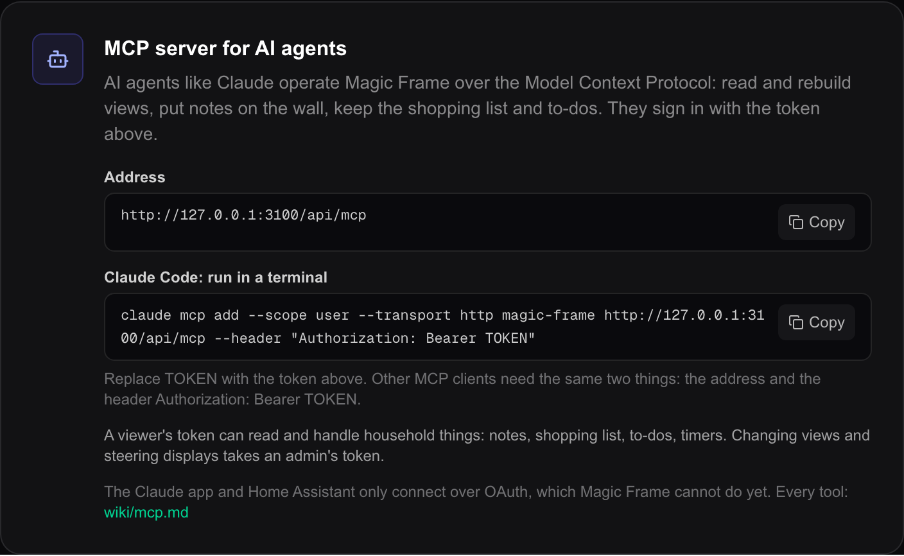

# Agents and MCP

Magic Frame has an MCP server built in. An AI agent that speaks the **Model
Context Protocol** — Claude Code, for example — connects to it and can do much
of what you would otherwise do by hand: read and rebuild views, set wallpapers,
put a note on the kitchen screen, keep the shopping list, start a timer.

The server is part of your own installation, at `/api/mcp` on the same address
as the editor. It is always on; an agent needs your token to use it.

A **view** is one screenful shown at one address (`/view/<id>`); its id is what
the tools call `dashboardId`. A **display** is any device showing a view. A
**tool** is one thing the server offers an agent, like `post_message`.

## What you can ask for

A few requests, and the tools an agent uses for them:

| You say | The agent uses |
| --- | --- |
| "Put 'Dinner at seven' on the kitchen screen for two hours." | `post_message` with the kitchen view and `ttlMinutes: 120` |
| "Add milk, eggs and bread to the shopping list." | `add_shopping_items` |
| "Start a ten-minute pasta timer." | `start_timer` |
| "What is on Sam's to-do list?" | `list_todos` with `assignee` |
| "Make the clock on the hallway view bigger and move it to the top right." | `get_view`, then `edit_widgets` |
| "Show the holiday album on the living-room view." | `browse_immich_albums`, then `set_wallpaper` |
| "Why does the garage button do nothing on the wall?" | `diagnose_ha_action` |

## Connecting

### What you need

1. **The address.** `http://` or `https://`, the address you reach the editor
   on, and `/api/mcp` — for example `http://192.0.2.10/api/mcp`.
2. **Your token.** The Companion API token from `Settings → Devices & apps`
   (`Einstellungen → Geräte & Apps`). How to get it and how to rotate it is in
   [The companion API](companion-api.md).
3. **One header** carrying the token: `Authorization: Bearer YOUR_TOKEN`.

The same page has a card, **MCP server for AI agents**, that shows the address
for your installation and a ready-made command for Claude Code, each with a
Copy button. The command carries the placeholder `TOKEN` rather than your real
token, so that pasting it into a forum post or an issue does not give the token
away.



The token goes in the header only. `?key=` in the address, which the companion
routes accept, is refused here on purpose: a token in an address ends up in
every proxy and access log on the way.

### Claude Code

Run this once in a terminal, with your address and your token:

```
claude mcp add --scope user --transport http magic-frame http://192.0.2.10/api/mcp --header "Authorization: Bearer YOUR_TOKEN"
```

`--scope user` makes the server available in every folder. Without it Claude
Code only knows it in the folder where the command ran. Then ask something like
"Which views does my Magic Frame have?".

### Other clients

Any MCP client that speaks the **HTTP** transport (also called *Streamable
HTTP*) and can send a header works the same way: the address, and the
`Authorization` header. The server answers `POST` only. A client that insists
on the older SSE transport and opens the address with `GET` gets `405` and
cannot connect.

### What cannot connect yet

The connectors in the Claude apps and the MCP integration in Home Assistant
sign in with **OAuth**. Magic Frame's server takes a token and does not offer
OAuth, so those two cannot connect yet. The Claude apps also reach a connector
from Anthropic's servers, not from your network, so they would need an address
that is reachable from the internet as well.

## Who may do what

The token belongs to one user, and that user's role decides which tools the
agent sees. A tool an agent may not use is not in its list at all, so an agent
never tries one and fails.

| Role | Tools |
| --- | --- |
| viewer | reading, and the household tools |
| admin | everything below |

**Reading** — any token:

| Tool | What it does |
| --- | --- |
| `get_widget_catalog` | the widget types and the grid rules; with a type, that widget's exact config schema |
| `list_views` | every view with its id, name, orientation and widget count |
| `get_view` | one view's full layout, wallpaper and settings; stored passwords and keys are only named in `storedCredentials`, never shown, and `set_wallpaper` keeps them as long as the address stays the same |
| `get_settings` | what is connected — Home Assistant, Immich — as true/false, never the secrets |
| `list_ha_entities` | Home Assistant entities, filtered by domain or a search word |
| `diagnose_ha_action` | whether a display would be allowed to act on an entity, and why |
| `list_snapshots` | the saved restore points per view |
| `list_displays` | which displays are showing a view right now, with their screen sizes |
| `browse_immich_albums` | the albums in the Immich connection, with ids |

**Household** — any token, the same as the [companion routes](companion-api.md):

| Tool | What it does |
| --- | --- |
| `list_messages`, `post_message`, `dismiss_message` | notes on the Messages widget; `post_message` takes `dashboardId`, `ttlMinutes` and `imageUrl` |
| `list_shopping`, `add_shopping_items` | the shopping list; several items in one call |
| `check_shopping_item` | ticks an item off (`checked: true`) or puts it back (`checked: false`) |
| `clear_checked_shopping` | removes every ticked-off item |
| `list_todos`, `add_todo` | household to-dos, with `assignee`, `dueDate` and `priority` |
| `complete_todo` | marks a to-do done (`done: true`) or opens it again |
| `list_timers`, `start_timer`, `stop_timer` | countdowns on the Timer widget, 24 hours at most |

`check_shopping_item` and `complete_todo` set a state rather than flip it, so an
agent that sends the same request twice does not undo its own work.

The shopping list and the to-dos here are Magic Frame's own, the source called
**Local** in the widgets. A Shopping list or To-dos widget set to a Home
Assistant list or a Todoist project keeps its items there, and these tools do
not reach them; see [Family widgets](widgets-family.md).

**Setting up** — admin token only:

| Tool | What it does |
| --- | --- |
| `edit_widgets` | adds, changes, moves or removes widgets on a view, all in one call |
| `replace_view_layout` | replaces a view's whole layout |
| `set_wallpaper` | changes only a view's wallpaper |
| `manage_view` | creates, duplicates, renames or deletes a view |
| `create_snapshot`, `restore_snapshot` | saves a restore point, or goes back to one |
| `control_displays` | sends every display to a view, reloads them, lifts a forced view, or shows the next wallpaper picture |

**Rotating the token** on the settings page cuts off every agent using it at
once. A token cannot be used to fetch or make a token; that needs a signed-in
browser.

## What keeps an agent from breaking things

- **The same save as the editor.** A view an agent changes goes through the
  same checks as **Save** in the editor: every widget's config is validated
  against its schema, widget ids get the view's prefix, and buttons that show
  or hide other widgets keep pointing at the right ones. The displays follow
  within a second.
- **Restore points.** Every change to a view — `edit_widgets`,
  `replace_view_layout`, `set_wallpaper` — saves a snapshot of the view first,
  the same `auto-save` the editor's **Save** makes. `restore_snapshot` saves
  one of the current state before it goes back, so a restore can be undone too.
- **Two steps for the irreversible.** Deleting a view and restoring a snapshot
  both need `confirm: true`. Without it, `manage_view` answers how many widgets
  the delete would remove.
- **Errors that explain.** A failed call says what was wrong and what to do —
  the valid view ids, the schema to fetch, the date format to use — so the
  agent can correct itself instead of guessing.

## What the agent sees goes to its AI service

Magic Frame itself sends nothing to an AI service. But whatever an agent reads —
your view names, entity names, the shopping list, the notes on the wall —
becomes part of its conversation, and that conversation goes to whichever AI
service runs the agent. A viewer's token limits what an agent can change, not
what it can read.

## What this cannot do

- **No OAuth.** See [What cannot connect yet](#what-cannot-connect-yet).
- **No single display.** `control_displays` acts on every display at once, or
  on every display showing one view. It cannot pick one tablet.
- **No calendar or weather tool.** An agent that can fetch addresses can read
  `GET /api/calendar` and `GET /api/weather` the way the displays do; see
  [The companion API](companion-api.md).
- **No Todoist or Home Assistant lists.** The list tools work on the Local
  lists only.
- **No uploads.** A note can point at a picture by its address (`imageUrl`),
  not carry one.
- **Ownership is not checked.** Like the companion routes, any token can stop
  any timer and tick off any item, whoever created it.

## Where this lives in the code

| Part | File |
| --- | --- |
| The endpoint | `src/app/api/mcp/route.ts` |
| Signing in with the token | `src/lib/mcp/auth.ts` |
| Every tool | `src/lib/mcp/server.ts` |
| The widget catalogue | `src/lib/mcp/catalog.ts` |
| Errors that explain | `src/lib/mcp/errors.ts` |
| The settings card | `src/app/editor/(app)/settings/page.tsx` (`McpCard`) |
| A test against a throwaway install | `scripts/mcp-smoke.mjs` |
